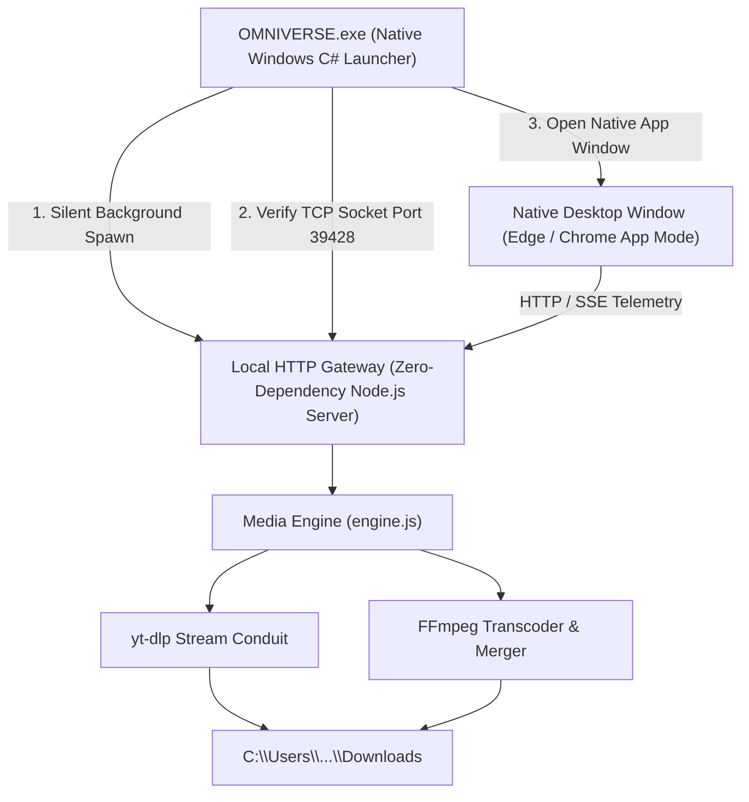

<div align="center">

# ✦ OMNIVERSE ✦
### *All streams within one luminous space.*

> *“Where infinite streams float like particles in pure light. Draw any video from the boundless expanse in its purest form.”*

<br/>

[](https://github.com/kmannnish/OMNIVERSE/releases/latest)
[](https://github.com/kmannnish/OMNIVERSE/releases/latest)
[](LICENSE)

<br/>

</div>

---

## 🌌 Overview

**OMNIVERSE** is a high-craft, single-window media manifestor and stream conduit themed around the philosophical concept of the **Luminous Expanse** (*Aksharbrahm Chidakash*). 

Designed with zero visual clutter, it transforms standard downloading into a serene, weightless experience with butter-smooth radial fill animations, ambient starlight micro-particles, and an interactive celestial cursor.

---

## ⚡ Core Capabilities

| Realm | Feature | Description |
| :--- | :--- | :--- |
| **Visual Form** | **Video Stream Manifestation** | Download up to **4K Ultra HD**, 1440p QHD, 1080p Full HD, and 720p with auto audio-video muxing (MP4 & WebM). |
| **Pure Essence** | **Audio Extraction** | Extract master-quality audio in **320kbps MP3**, 256kbps M4A, or pristine lossless WAV. |
| **Divine Words** | **Captions & Subtitles** | Extract multilingual subtitles and automatic captions in clean **SRT** or **VTT** formats. |
| **Radiant Vision** | **Thumbnail Art** | Download thumbnail art across all available resolutions (**1080p Ultra HD**, 720p, 480p, 360p) in **JPG**, **PNG**, or **WEBP**. |
| **Autonomous Engine** | **Zero Docker & Zero Setup** | Bundles local Node.js runtime, `yt-dlp`, and `FFmpeg` inside a single installer. |

---

## 📦 Installation & Download

### 🚀 Standard Desktop Installation (Recommended)
1. Download **`OMNIVERSE-Setup.exe`** from the [**Latest Release**](https://github.com/kmannnish/OMNIVERSE/releases/latest).
2. Double-click the installer. It displays a celestial extraction window with real-time progress.
3. Once completed, launch **OMNIVERSE** from your Desktop shortcut or Windows Start Menu.

---

## 🏛 Technical Architecture



---

## 🛠 Developer Setup

If you wish to build or run OMNIVERSE from source:

### Prerequisites
* [Node.js](https://nodejs.org/) (v18+)
* [yt-dlp](https://github.com/yt-dlp/yt-dlp) & [FFmpeg](https://ffmpeg.org/) (available in PATH)

### 1. Clone the Repository
```bash
git clone https://github.com/kmannnish/OMNIVERSE.git
cd OMNIVERSE
```

### 2. Install Dependencies & Build
```bash
npm install
npm --prefix shared run build
npm --prefix frontend run build
```

### 3. Run Standalone Server
```bash
node desktop/server.js
```
Open [http://127.0.0.1:39428](http://127.0.0.1:39428) in your browser.

---

## 📜 Philosophy

> *“Boundless reach. Radiant clarity. All streams within one luminous space.”*  
> Inspired by the eternal philosophical concepts of *Jiv*, *Ishwar*, *Maya*, *Aksharbrahm*, and *Parabrahm*.

---

## 📄 License
This project is licensed under the [MIT License](LICENSE).
